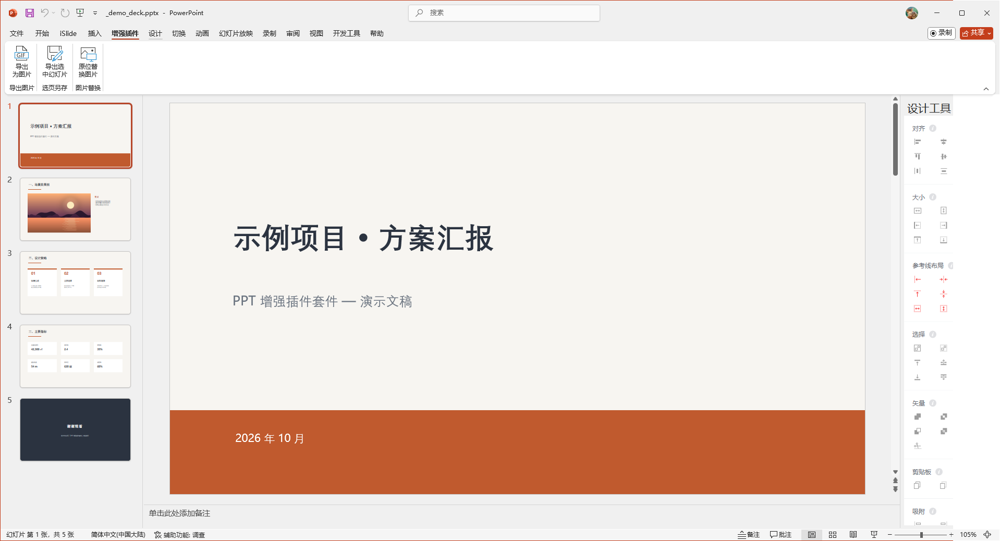
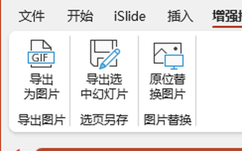
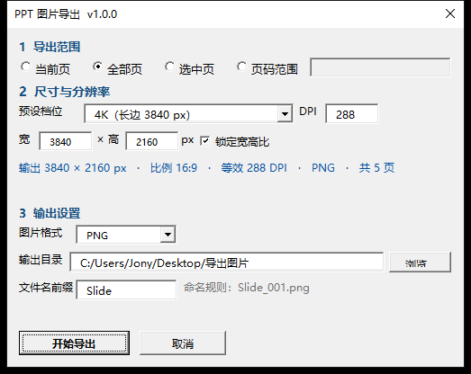
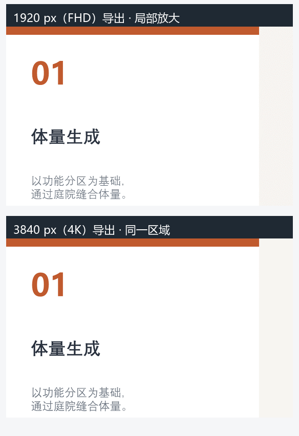
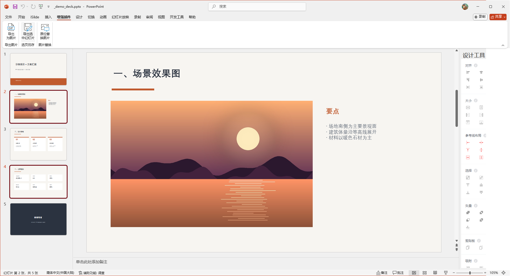
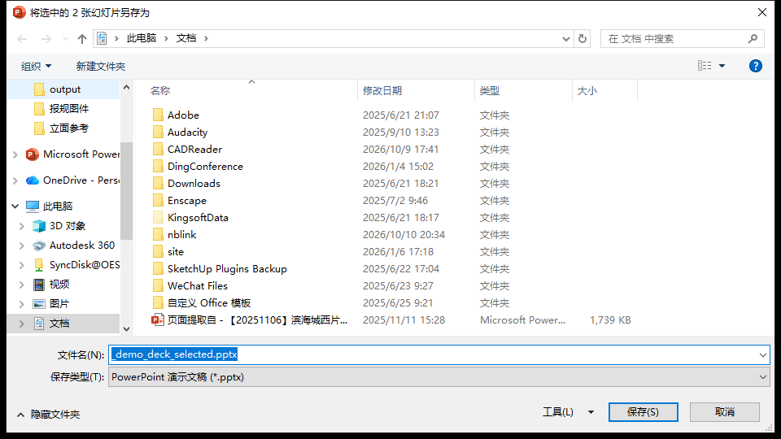
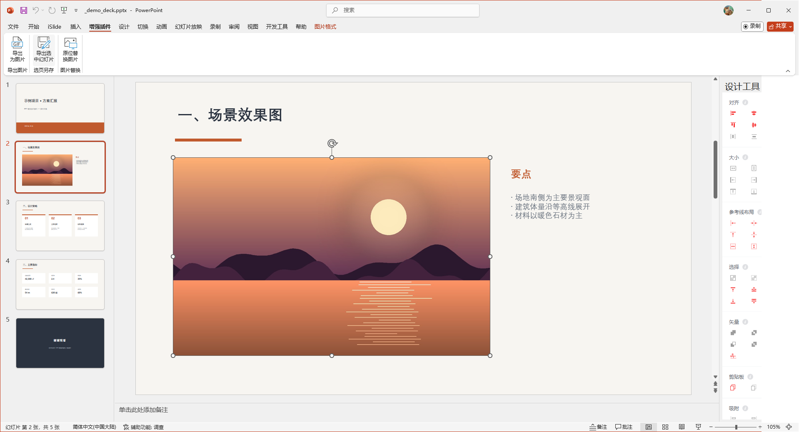
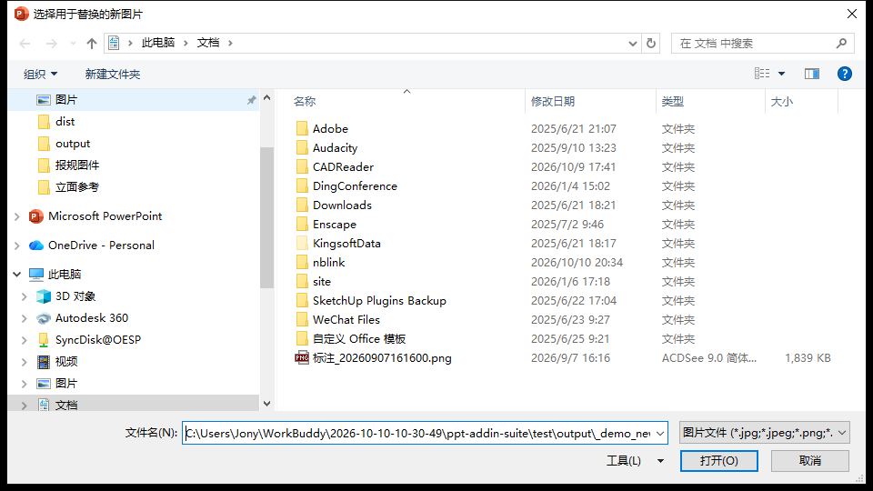
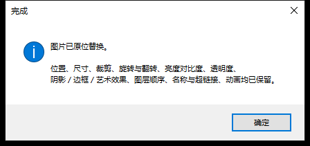

# PPT 增强插件套件 v1.0.0

*使用说明 · 适用于 Windows 版 PowerPoint 2016 / 2019 / 2021 / Microsoft 365 · 更新日期 2026-10-11*

## 目录

1. 套件简介与下载
2. 安装与卸载
3. 插件一：导出为图片
4. 插件二：导出选中幻灯片（选页另存）
5. 插件三：原位替换图片
6. 常见问题
7. 开发与共建

## 一、套件简介与下载

一组根据自己常用需求、使用 VBA 宏写的 PowerPoint 加载项「增强插件」，目前包括按像素 / DPI 精确导出图片、导出选中幻灯片、原位替换图片（位置 / 尺寸 / 裁剪 / 旋转等属性零损失）。安装后随 PowerPoint 自动加载，无需手动开启。

> **下载：**在 [Releases 页面](https://github.com/caojiezi2003/ppt-addin-suite/releases/latest) 下载最新的 `PptEnhanceSuite.ppam`，然后按第二节安装即可 —— 单文件、免注册组件、无其它依赖。

| 按钮 | 所在分组 | 一句话说明 |
| --- | --- | --- |
| **导出为图片** | 导出图片 | 按自定义分辨率（最高 8K / 印刷级 600 DPI）把幻灯片导出为 PNG / JPG / TIFF / BMP，绕过 PowerPoint 自带「另存为」固定 96 DPI 的限制。 |
| **导出选中幻灯片** | 选页另存 | 在缩略图窗格勾选若干页，一键另存为一份新的 .pptx，版式、母版、主题、备注、动画、切换 100% 保留。 |
| **原位替换图片** | 图片替换 | 选一张图片换掉，位置、尺寸、裁剪、旋转、图层、动画等所有版式属性原样保留，新图不会「跳」到最顶层。 |

安装完成后，功能区会出现 **「增强插件」** 标签（位于「插入」之后）：

### 三个按钮一览

## 二、安装与卸载

### 2.1 环境要求

| 项目 | 要求 |
| --- | --- |
| 操作系统 | Windows 10 / 11 |
| Office | PowerPoint 2016 及以上（32 / 64 位均可） |
| 文件 | `PptEnhanceSuite.ppam`（约 124 KB，单文件即插即用） |

### 2.2 安装步骤

如果插件已经由安装脚本装好（文件位于 `%APPDATA%\Microsoft\AddIns\PptEnhanceSuite.ppam` 并已登记随启动自动加载），可以跳过本节，直接看 2.3 验证安装。

1. 关闭所有 PowerPoint 窗口。
2. 把 `PptEnhanceSuite.ppam` 复制到一个**固定位置**（推荐 `%APPDATA%\Microsoft\AddIns\`，即「文档」地址栏直接输入后回车打开的 `C:\Users\你的用户名\AppData\Roaming\Microsoft\AddIns`）。
3. 打开 PowerPoint，依次点击 **文件 → 选项 → 加载项**，在页面底部把「管理」下拉框切换为 **「PowerPoint 加载项」**，点「转到」。
4. 在弹出的加载项窗口中点 **「添加」**，选中刚才的 `PptEnhanceSuite.ppam`，确认它在列表中处于**勾选**状态，关闭窗口。
5. 重启 PowerPoint。

> **宏安全提示：**本插件未做数字签名。若功能区没有出现「增强插件」标签，请检查：**文件 → 选项 → 信任中心 → 信任中心设置 → 加载项**，确认没有勾选「要求应用程序扩展受到受信任发布者签署」；并在 **信任中心 → 宏设置** 中选择「禁用无数字签署的所有宏（通知）」或更宽松的选项，然后重新加载插件。若曾弹过安全提示且选择了「禁用」，可在 **文件 → 信息 → 启用内容** 里重新启用。

### 2.3 验证安装

打开任意演示文稿，功能区内出现 **「增强插件」** 标签、且能看到下图中三个带图标的按钮，即安装成功。将鼠标悬停在按钮上会显示功能提示（screentip / supertip）。

### 2.4 卸载

1. **文件 → 选项 → 加载项 → 管理：PowerPoint 加载项 → 转到**，取消勾选 `PptEnhanceSuite`（取消勾选仅本次不加载；点「删除」则彻底移出列表）。
2. 删除文件 `%APPDATA%\Microsoft\AddIns\PptEnhanceSuite.ppam`。
3. （可选）彻底清理登记项：删除注册表键 `HKEY_CURRENT_USER\Software\Microsoft\Office\16.0\PowerPoint\AddIns\PptEnhanceSuite`。

## 三、插件一：导出为图片（导出图片分组）

### 3.1 解决什么问题

PowerPoint 自带的「另存为图片」固定输出 **96 DPI**，投屏发虚、印刷不可用。本插件按**像素 / DPI** 精确控制输出分辨率，并提供常用档位一键选择。

### 3.2 操作步骤

1. 打开演示文稿，点击功能区 **「增强插件 → 导出为图片」**，弹出设置面板：

2. 选择**导出范围**、**尺寸与分辨率**、**图片格式**与**输出位置**（各项见 3.3）。
3. 点击 **「开始导出」**。导出过程中面板底部实时显示进度（第几页 / 共几页），可随时点「中止」停止。
4. 完成后按状态提示打开输出目录查看图片。

### 3.3 参数说明

| 参数 | 说明 |
| --- | --- |
| **导出范围** | `当前页` / `全部页` / `选中页` / `页码范围` 「选中页」对应左侧缩略图窗格中选中的页；「页码范围」支持混合写法，如 `1,3,5-8`（逗号分隔、连字符表区间；中文逗号、`～`、`—` 等全角符号均可识别）。 |
| **预设档位** | `幻灯片原始尺寸（96 DPI）` / `FHD 1080P` / `2K` / `4K` / `5K` / `8K` / `印刷级 150 / 300 / 600 DPI` / `自定义` 档位按「长边像素」换算；印刷档按 DPI 换算。选择「自定义」后可手动填写。 |
| **DPI / 宽 × 高** | 三者联动换算：「宽」「高」任一改动即同步 DPI（勾选「锁定宽高比」时保持幻灯片比例）。面板中部会实时预览换算结果，例如 `输出 3840 × 2160 px · 比例 16:9 · 等效 288 DPI · PNG · 共 5 页`。 |
| **图片格式** | `PNG（无损，推荐）` / `JPG（体积小）` / `TIFF（印刷）` / `BMP` |
| **输出目录** | 默认为演示文稿所在目录下的 `导出图片` 子文件夹（文稿未保存过时为「图片」文件夹），可点「浏览…」修改。 |
| **文件名前缀** | 输出按 `前缀_页码序号.扩展名` 命名，如前缀 `Slide` 则为 `Slide_001.png`、`Slide_002.png`…（三位编号）。 |

> **小提示：**输出目录、格式、前缀、上次使用的尺寸等设置都会**自动记忆**，下次打开面板直接就是上次的状态；想恢复默认可在注册表删除 `HKEY_CURRENT_USER\Software\VB and VBA Program Settings\PptImageExport` 后重新打开面板。

### 3.4 导出效果参考

同一页分别在 FHD 与 4K 档位下导出，放大后对比 —— 文字与线条边缘的差距非常明显：

## 四、插件二：导出选中幻灯片（选页另存分组）

### 4.1 解决什么问题

评审只发部分页、从大合集里抽出某几页给同事 —— 复制粘贴到新文件容易丢母版和动画。本插件直接生成一份「只含所选页」的新 .pptx：**整本另存为副本后删除未选页**，因此版式、母版、页面尺寸、主题、备注、动画与切换效果 **100% 保留**。

### 4.2 操作步骤

1. 在左侧**缩略图窗格**中选中要导出的页：单击选一页；按住 `Ctrl` 单击可多选不连续的页；按住 `Shift` 单击可选连续区间。下例中选中了第 2、4 页：

2. 点击功能区 **「增强插件 → 导出选中幻灯片」**，弹出「另存为」对话框，文件名默认为 `原文件名_selected.pptx`：

3. 确认保存位置与文件名，点「保存」。完成后弹窗显示导出页数与文件路径。

> **小提示：**导出的是一份**新文件**，当前演示文稿不受任何影响；新文件中的页码会重新从 1 开始编排。

## 五、插件三：原位替换图片（图片替换分组）

### 5.1 解决什么问题

客户临时换图，但图片上的裁剪、亮度、动画都调好了 —— 直接删除重插等于重做一遍。本插件把新图**原位换入**，以下属性全部保留：

`位置与尺寸` / `裁剪` / `旋转与翻转` / `亮度 / 对比度` / `透明度` / `阴影 / 边框 / 发光 / 艺术效果` / `图层顺序（不会跳到最顶层）` / `名称 / 替代文字 / 超链接` / `动画`

### 5.2 支持的三种选取方式

| 方式 | 操作 |
| --- | --- |
| ① 直接选中 | 在幻灯片上单击选中那张图片。 |
| ② 选中组合 | 选中一个**内含唯一图片**的组合，插件自动替换组合里那张图。 |
| ③ 进入组合点选 | **双击进入组合**后，单击组内要替换的那张图片（组合里有多张图片时必须用这种方式）。 |

### 5.3 操作步骤

1. 按上述任一方式选中图片（下例：幻灯片上的图片处于选中状态，四周出现控制点）：

2. 点击功能区 **「增强插件 → 原位替换图片」**，在弹出的文件对话框中选择新图片（支持 JPG / PNG / BMP / TIF / GIF）：

3. 点「打开」执行替换，完成后弹窗确认：

替换前后对比 —— 版面完全没动，只有图片内容变了：

> **已知边界（多层编组）：**「组中还有组」的多层嵌套组合场景尚未充分验证。若替换多层编组内的图片出现异常，建议先**双击进入最内层组合后点选图片**（方式③），或临时解组后再替换。此问题已在后续完善计划中。

## 六、常见问题

### Q1：功能区里没有「增强插件」标签？

按顺序检查：① 是否重启过 PowerPoint；② **文件 → 选项 → 加载项 → 管理：PowerPoint 加载项 → 转到**，确认 `PptEnhanceSuite` 在列表中且已勾选；③ 参见 2.2 节的宏安全提示； ④ 若曾被「禁用文件」拦截，到 **文件 → 选项 → 信任中心 → 信任中心设置 → 受信任的加载项目录** 检查，或将 ppam 所在目录加入受信任位置。

### Q2：点「导出为图片」提示「请先打开一个演示文稿」？

插件需要至少打开一份演示文稿才能计算页面尺寸。先打开（或新建）一份文稿再点按钮。

### Q3：导出的图片去哪里找？

设置面板的「输出目录」栏显示了本次输出位置，默认在演示文稿同目录的 `导出图片` 子文件夹。导出完成提示中也会显示文件所在路径。

### Q4：替换时提示「所选组合里有 N 张图片，无法确定要替换哪一张」？

这是刻意的保护 —— 组合里有多张图片时插件不会猜。按 **5.2 节方式③**：双击进入组合，单击要替换的那张图，再点「原位替换图片」。

### Q5：替换后图片跑到最顶层了？

正常情况不会 —— 图层顺序属于被保留的属性。若遇到，请确认是通过本插件替换（选中图片 → 原位替换图片），而不是删除后重新插入。

### Q6：选中了文本框 / 形状点「原位替换图片」没反应？

插件只处理图片对象，选中非图片时会弹窗说明，这是预期行为。

### Q7：多台电脑使用，怎么分发？

把 `PptEnhanceSuite.ppam` 拷贝到目标电脑，按 2.2 节步骤安装即可；插件为单文件、免注册组件、无其他依赖。

## 七、开发与共建

本仓库同时面向开发者开放共建。架构设计、目录结构、构建方式、测试链，以及「如何继续新增插件 / 完善现有插件」的完整步骤与注意事项，见 [开发文档](开发文档.md)。

> **参与方式：**欢迎在 [Issues](https://github.com/caojiezi2003/ppt-addin-suite/issues) 反馈问题或提出需求，也欢迎直接提交 Pull Request。

---

PPT 增强插件套件 v1.0.0 · 使用说明 · 2026-10-11
安装位置：`%APPDATA%\Microsoft\AddIns\PptEnhanceSuite.ppam` · 随 PowerPoint 启动自动加载
项目地址：[github.com/caojiezi2003/ppt-addin-suite](https://github.com/caojiezi2003/ppt-addin-suite)

<!-- 配图位于同目录 screenshots/ 下；本文与 使用说明.html / PDF 版内容一致，由 _build_doc.py 统一生成。 -->
